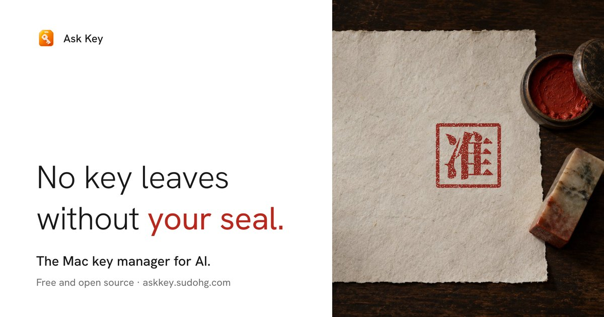
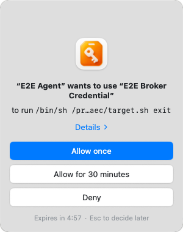
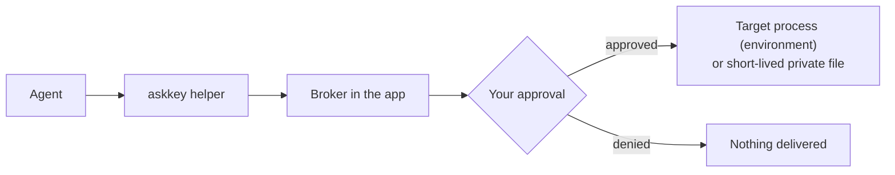
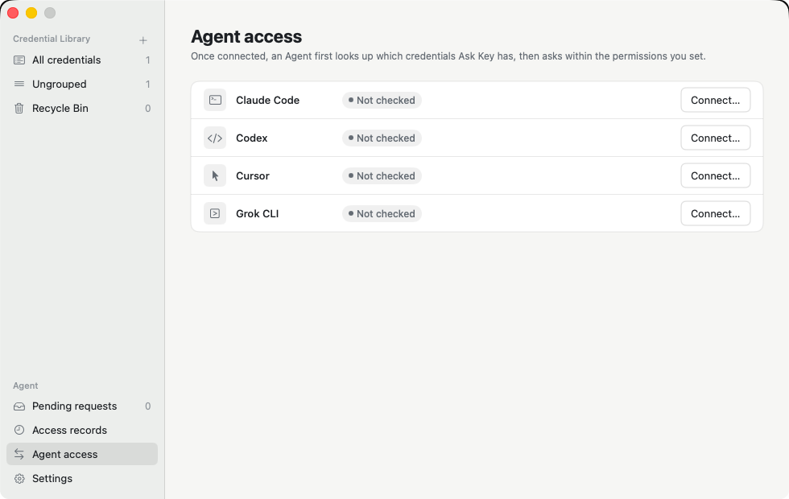

<p align="center">
  <a href="https://askkey.sudohg.com/"></a>
</p>

# Ask Key

<p align="center"><a href="README.zh-CN.md"></a></p>

[](https://github.com/sudoHG/AskKey/actions/workflows/ci.yml) [](https://github.com/sudoHG/AskKey/releases/latest) [](https://github.com/sudoHG/AskKey/releases) [](#install) [](https://github.com/sudoHG/AskKey/stargazers) [](LICENSE) [](https://hits.sh/github.com/sudoHG/AskKey/)

**The Mac key manager for AI.** Your keys stay encrypted on your Mac, and AI agents use them only through Ask Key:

- **Find keys:** agents look up what they need in Ask Key's catalog, so you stop pointing the way.
- **Your rules:** everyday keys pass, sensitive ones wait for your approval, and some stay hidden.
- **Locked down:** a key goes only to the program that needs it; the agent never sees the value.

**[Download for Mac](https://github.com/sudoHG/AskKey/releases/latest/download/AskKey.dmg)** (free, notarized, Apple silicon, macOS 14 or later) · [Website](https://askkey.sudohg.com/)

> **Settings → Export Backup…** saves every credential to one encrypted file that only its recovery key opens. See [Backup](#backup).

<p align="center">
  
</p>

## Why it exists

Coding agents need real secrets to deploy code, call APIs or log in to servers. The usual shortcuts are pasting a key into a chat, writing it into a prompt or leaving it in a `.env` file. Each of those hands plaintext to every tool, transcript and log that can read it, and you rarely see which agent used what.

Ask Key takes the secret out of that path. The agent never holds the stored value. It asks, you decide, and the value goes only to the program that needs it.

## Install

1. Download [AskKey.dmg](https://github.com/sudoHG/AskKey/releases/latest/download/AskKey.dmg) and [AskKey.dmg.sha256](https://github.com/sudoHG/AskKey/releases/latest/download/AskKey.dmg.sha256) from the latest release.
2. In the download directory, verify the checksum before opening the DMG:

   ```bash
   shasum -a 256 -c AskKey.dmg.sha256
   ```

   Continue only if the check reports `OK`.
3. Open the DMG and drag `Ask Key.app` into Applications. It must stay at exactly `/Applications/Ask Key.app`, under that name, or agents cannot connect.
4. Launch Ask Key and follow the three steps below.

To upgrade or remove it later, see [Upgrade](#upgrade) and [Uninstall](#uninstall).

### Start in three steps

The welcome page walks you through the same steps.

1. **Store a credential.** Choose **New Credential**, or **Import from File…** to bring in a `.env` file. New credentials default to **Ask every time**.
2. **Connect your Agent.** Open the **Agent access** page and choose **Connect…** next to Claude Code, Codex, Cursor or Grok CLI. See [Supported clients](#supported-clients).
3. **Try it once.** Send your Agent the sample prompt from **Agent access**, for example "Use Staging API from Ask Key to run a command that checks its variables are set, without printing their values". Ask Key shows an approval prompt; choose **Allow once**. The Agent sees only the command's output, and the use appears in **Access records**. In your projects, ask for real commands such as `./deploy.sh` the same way.

## Windows

Ask Key itself is a macOS app. Community contributors maintain third-party Windows ports in their own repositories:

- [A1mAssist/AskKey](https://github.com/A1mAssist/AskKey): C# and WinUI
- [WENGENG-boop/AskKey-Windows](https://github.com/WENGENG-boop/AskKey-Windows): Rust and Tauri

## How it works

Ask Key stores text credentials (API keys, tokens, passwords) and files (SSH keys, `.p8`, PEM, service-account JSON). One credential can have several parts, each mapped to an environment variable name. You add credentials by hand or import a `.env` file in the app.



An agent first reads a catalog of credential names, usage instructions and variable mappings. The catalog never contains values. When the agent needs a credential, it runs its command through the helper, and the Broker inside the app decides whether to ask you. After approval, text parts become environment variables of the target process, and file parts are written to a random file in a private directory that is removed after a short time. The agent gets the target's output (through the helper) or just its exit status (through MCP), never the stored value.

```bash
askkey run --wait-for-approval \
  --credential "Staging API" \
  --operation-id deploy-001 \
  --caller-name "Codex" --caller-purpose "Deploy staging" \
  -- ./deploy.sh
```

The helper ships inside the app bundle at `Contents/Helpers/askkey`. The target gets only the selected credentials, under the variable names set on each part, plus a filtered copy of the inherited environment.

## Permissions

Each credential has one permission:

| Permission | Effect on agents |
|---|---|
| Allow | Agents can use it without a prompt. Delivery still goes through the Broker. |
| Ask every time (default) | Every use waits for your approval. |
| Hidden | Not in the agent catalog; agents cannot request it. |

When you approve a read, you choose **Allow Once** or a timed allowance: a number of minutes during which that credential can be read without asking again, until it ends or you revoke it. For a grouped credential, you can also allow the eligible credentials listed in **Details** together. Later additions are excluded, and the whole allowance ends at the earliest member expiry if that is sooner. Active allowances appear at the top of the library with remaining time and revocation actions; **Revoke Group Allowance** ends the whole grant. Pending requests expire after five minutes.

In **Settings**, **End Timed Allow on Lock** is off by default and requires system authentication to turn on or off. Once enabled in this process, screen lock, sleep or user switch ends single and group timed allowances and unconsumed timed approvals, and cancels prepared runs containing a timed credential. New timed grants are refused while locked, asleep or switched out, including when the screen state is unknown. See [SECURITY.md](SECURITY.md) for the adoption and sleep limitations.

Agents can also write: create, modify or delete a credential, set its usage instructions and group, or move credentials and create, rename or delete groups in one batch. Every write needs your approval for that operation (a batch is approved once), the approval is tied to the exact content you were shown, and it cannot be reused for another change. Permanent deletion stays in the app.

## Supported clients



Claude Code, Codex, Cursor and Grok CLI. Open the app's **Agent access** page, check a client, then confirm. For each client, setup:

- adds Ask Key as an MCP server in the user-level configuration, keeping a private backup and your other settings;
- installs a discovery hook that reminds the agent to look up the catalog before common direct SSH commands;
- verifies the configuration, the bundled helper and the Broker before it reports the client as connected.

Setup runs only when you ask for it, and writing a client's configuration needs system authentication. Discovery hooks are reminders, not authorization.

### Other MCP clients

Any client that supports standard MCP stdio servers can connect to Ask Key by defining a server with:

- `command`: `/Applications/Ask Key.app/Contents/Helpers/askkey`
- `args`: `["mcp"]`

Manual setup does not include automatic discovery reminders before SSH commands or connection verification in the app. Broker permissions, approval prompts, and credential delivery protections still apply.

## Security model

The full policy, including how to report a vulnerability privately, is in [SECURITY.md](SECURITY.md). In short:

- Credentials are encrypted locally. Responses from Ask Key's management, MCP and helper interfaces do not contain stored plaintext.
- Revealing or copying a stored value in the app requires fresh system authentication.
- Revoking, expiring or pausing stops deliveries that have not started and cleans up temporary files.

What Ask Key does not guarantee:

- An approved target can print, copy or forward what it receives.
- Caller names and purposes are declared by the agent. They help you read a request; they are not verified identity.
- Another process running as the same macOS user may be able to read material after an approved delivery. Hidden keeps a credential out of the agent catalog but does not defend against that.
- A timed allowance covers one credential or the explicitly approved group snapshot for the whole local user, not one agent client. Later group additions are excluded; writes still need separate approval.

## Backup

**Export Backup…** in Settings → Backup writes the whole credential library to one `.askkeybackup` file: every credential, including Hidden ones and those in the Recycle Bin, with usage instructions, private notes, groups and expiry dates. Exporting needs system authentication. Ask Key then shows a newly generated recovery key once; type its last group to confirm you saved it, then choose where the file goes.

The file is encrypted with AES-256-GCM under a key derived from the recovery key, and its name and unencrypted bytes reveal no credential names, so it can live in iCloud Drive, on a NAS or on a USB disk. Its protection rests entirely on the recovery key: anyone with both the file and the key can read every credential in it, and without the key nobody can open it, Ask Key included. Ask Key never stores the key, so keep it apart from the file, for example in a password manager.

**Import Backup…** in the same section, or **Restore from Backup…** on the first-run screen of a new Mac, opens a backup with its recovery key and shows what it will add, rename and skip before anything is written. Importing needs system authentication and only adds: nothing in the library is deleted or overwritten, a credential that is already there with the same contents is skipped, and one whose name is taken by different contents arrives as "*name* (from backup)" so you can compare the two. Credentials that were Allow arrive as Ask every time, and Hidden ones stay Hidden. To combine two Macs' libraries, import each Mac's backup on the other. Agents cannot export, inspect or import backups. The design is recorded in [ADR 0012](docs/adr/0012-encrypted-backup-export-and-import.md).

Ask Key 0.6.0 and earlier have no backup, so keep the originals of your credentials elsewhere while you use those versions.

## Upgrade

Before updating to 0.6.0, quit Ask Key. Download and verify the new DMG as described in [Install](#install), replace `/Applications/Ask Key.app` with the app from the new DMG, then open Ask Key from Applications.

Upgrading from 0.5.0 does not migrate the library or require a library backup for this upgrade. Credentials, permissions, Agent access settings and **End Timed Allow on Lock** are kept without a Resume step. Version 0.5.0 has no updater, so install 0.6.0 by hand as described above; later releases arrive through [in-app updates](#in-app-updates).

Downgrading to 0.5.0 keeps the library and settings; 0.5.0 ignores the updater's preferences and has no updater.

For upgrades from 0.4.0 or earlier, also read the migration and compatibility notes for the intervening versions in [CHANGELOG.md](CHANGELOG.md#050---2026-11-03).

### In-app updates

Starting with 0.6.0, Ask Key can update itself. On the second launch, Ask Key asks whether to check for updates automatically, once a day. You can change that later with **Check for Updates Automatically** in Settings → General, and check at any time with **Check for Updates…** there, in the menu bar icon's menu or in its right-click menu. Nothing is installed until you confirm it. Installing relaunches Ask Key once no request is waiting or running; after the relaunch, Ask Key is locked again and timed allowances have ended. Connected agents need no setup change: the install path, the helper and the Broker protocol stay the same, and running helpers keep working. Tools added in a new version appear after the agent restarts its MCP server. Only the official copy at `/Applications/Ask Key.app` checks for updates; development and test builds never do. The update windows follow Ask Key's language setting; after you change it, they switch the next time Ask Key opens.

Update checks are Ask Key's only outbound network requests. A check requests `https://askkey.sudohg.com/appcast.xml` through Cloudflare, which redirects to the appcast attached to the latest [GitHub Release](https://github.com/sudoHG/AskKey/releases); an update downloads from GitHub. Both see your IP address. Requests carry the `User-Agent` `Ask Key/<version> Sparkle/<version>` and the standard headers macOS adds, such as your preferred languages; no system profile is sent. The appcast and the update must carry valid signatures from Ask Key's EdDSA key before anything is installed. With automatic checks off, Ask Key makes no request until you choose **Check for Updates…**. The exact requests are recorded in [ADR 0011](docs/adr/0011-in-app-updates.md).

Version 0.5.0 and earlier have no updater: watch [GitHub Releases](https://github.com/sudoHG/AskKey/releases) and update as described above.

## Uninstall

Quit Ask Key and delete `/Applications/Ask Key.app`. For each connected client, remove only the Ask Key entries and owned files listed in [What setup writes](docs/client-integrations.md#what-setup-writes), including MCP configuration, discovery Hooks and Ask Key-specific Hook trust settings (for example, for Claude Code, run `claude mcp remove askkey --scope user` and remove Ask Key handlers from `~/.claude/settings.json`). Preserve unrelated client settings and Hooks. There is no in-app way to disconnect a client.

You can optionally erase the local credential library as well. **This permanently destroys all stored credentials and cannot be undone.** Export a backup first if you may want them back. To do so, delete `~/Library/Application Support/AskKey` and use Keychain Access to delete the keychain item with service `com.sudohg.askkey.vault`.

## Build from source

Requirements: macOS 14 or later, and Xcode with a Swift 6 toolchain.

```bash
swift build
swift test
make run
```

`make run` builds a Debug app and starts it with separate development data, key material and socket, so it never touches an installed copy of Ask Key. Use synthetic credentials when trying it out. See [CONTRIBUTING.md](CONTRIBUTING.md) for the full requirements, UI test flow and pull request checks.

## Documentation

The [documentation index](docs/README.md) lists every guide and architecture decision. To find your way around the code, start with the [architecture guide](docs/architecture.md); [testing.md](docs/testing.md) explains the local checks and the desktop flows that run in CI.

## License and credits

MIT. See [LICENSE](LICENSE) and [NOTICE](NOTICE). Ask Key started as a fork of [Lokalite](https://github.com/RubenGlez/lokalite) by Ruben González Alonso; the product and most of the code have since been rewritten. The Chinese product name is 请旨.
